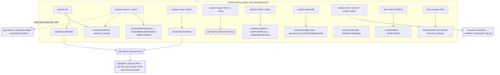

# Sessions and plan watching

A **session** is one engine run, named by a harp (`swift-amber-falcon`), bound
to a transcript. `ctxloom session *` browses, edits, keeps, removes, purges,
adopts and watches them, lists their transcripts and worktrees, and lists the
plan approvals a live coordinator is holding. Every listing reads one read
model, `operations.SessionView` (only the CLI listings ask it for a session's
state; see below).

ctxloom does not compact sessions: the engines compact their own context and
resume their own sessions. There is no agent-facing session tool; the only
in-session recall is the engine's own.

## Structure

## Row/render types

- `SessionRow` (`session_row.go`) is the projection `session list` and
  `session search` render: summary (the session's title), harp, state,
  start/end, and the purged and kept marks. It is projected from
  `operations.SessionView`, never from the store's entry.
- The title is `operations.SessionTitle`: the first main-thread user prompt of
  the session's canonical transcript, cut to its first line and 80 bytes
  (`sessions.FirstLineSummary`). It is read when the session is listed — one
  transcript parse per row — and never stored. A session whose transcript
  holds no prompt has no title; the row shows `(no summary)`.
- `sessionTime` is a `time.Time` newtype so the same field marshals RFC3339
  for structured formats and a compact local timestamp for text/markdown.
  This works because `clifmt`'s reflective renderer treats any `fmt.Stringer`
  field as a scalar; without the wrapper a table cell shows `time.Time`'s
  verbose default form.
- `emitSessionRows` is the shared render tail for both listings.
- `session show` emits the `SessionView` itself, its text form one fact per
  line (`renderSessionShow`).
- `StartSessionInfo` / `PrintStartSessionBanner` (`session_banner.go`) are
  `run`'s pre-spawn banner.

## Transcript retention: `session keep`

A session's transcript is its record, so every destroyer of transcripts asks
`sessions.Retention` first: a transcript is reclaimable once its session ended
(the later of its recorded end and its last activity) more than
`session_transcript_retention` ago (default `30d`), unless the session is
marked keep. `session keep <harp>` sets `keep` in the session's sidecar;
`--undo` clears it. An internal one-shot's transcript is reclaimable at any
age. The refusals are typed (`sessions.ErrTranscriptRecent`,
`ErrTranscriptKept`, `ErrNoRetentionBound`, wrapped by
`operations.ErrPurgeRetained`), and the CLI resolves the cutoff once
(`transcriptRetention`).

## How runs ended: `run_ends`

`Entry.RunEnds` (`run_ends` in `session.yaml`) records how each of the
session's runs ended, oldest first. Each entry has the run id, the time, the
terminal cause and its detail, `exit_code` when one was observed (128+signum
for a signal, so an OOM kill reads 137), and `failed`. A run's later end
replaces its earlier one, so a resume that fails to launch does not erase the
end of the run it resumed. The list keeps the newest `sessions.MaxRunEnds`
entries; the coordinator's run journal keeps all of them. It is written by
the coordinator at every run's end (see agentcoord/child-lifecycle.md, "What
an end records").

## Session state: the lock, not the end stamp

A record's `ended_at` (`Entry.EndedAt`, `SessionView.EndedAt`) is when the
session's **last run** ended. Only a coordinator-resumed child reuses its
harp, and a resume keeps the stamp, so `ended_at` can predate a run that is
live right now; nothing reads liveness from it. Liveness has one source, the
session's liveness lock (`internal/shared/sessionlock`), and its three
verdicts are the three states:

| lock verdict | state | END column |
|---|---|---|
| Alive (held) | `live` | blank, even when `ended_at` is set |
| Dead (free) | `ended` | `ended_at` |
| Indeterminate (no lock file, untrusted filesystem, failed probe) | `unknown` | `ended_at` |

`operations.ViewSessions(entries, probe)` asks a `SessionStateProbe` once
per row and puts the answer in `SessionView.State` (`state` in JSON).
`operations.LockSessionState` is the production probe (a non-blocking
`sessionlock.Inspect` that never creates the file), and the TUI roster's
index rows use the same function, so the overlay and the listing speak one
vocabulary. `session list` and `session search` pass it, so the text table's
STATE column, every structured format and search agree. Search does not
match a live row's stale end stamp, because it matches what the row shows.
Both commands take `--state live|ended|unknown`. A caller that passes no
probe gets no state: one running inside a session's own process must not
probe its own lock.

That last point is the in-process hazard. On the fcntl-emulated platforms,
a probe by the lock's own holder opens and closes a second descriptor on
its locked file, which drops the lock. `sessionlock.Acquire` (and so
`Inspect`) therefore answers a harp this process holds as Alive from
memory, without touching the file. The only in-process caller, the TUI
roster's own row, is safe for that reason. A container sees no lock file,
so its sessions list as `unknown`.

## `plan watch`

A long-lived debounced JSONL stream of plan-file changes, hidden because it is
GUI-facing. `planChangeEvent` is the entire wire contract:
`{"event":"changed","kind":"plans"}` — two constant strings, no path, no harp,
no project. The watch root is `paths.HomeSessionsDir()`, i.e. *every*
project's sessions, so a GUI watching one project is woken by every other
project's plan writes and must re-query. That is a deliberate "dumb client
re-queries" design; the watch plumbing lives in the backend so a frontend never
touches `~/.ctxloom` itself. The debounce (`planWatchDebounce`) coalesces the
burst of filesystem events one plan write produces into one logical change.

## Invariants

- **Listings serialize as `[]`, not `null`.**
- **A purged or kept session is visible as such in every format.**
  `SessionRow.Purged` and `SessionRow.Kept` are plain booleans for structured
  consumers and the same facts ride the `Summary` badge, so neither reads, in
  a table a human is looking at, as indistinguishable from a session with
  neither mark.
- **No destroyer of transcripts takes one Retention keeps**, and no flag
  overrides it.
