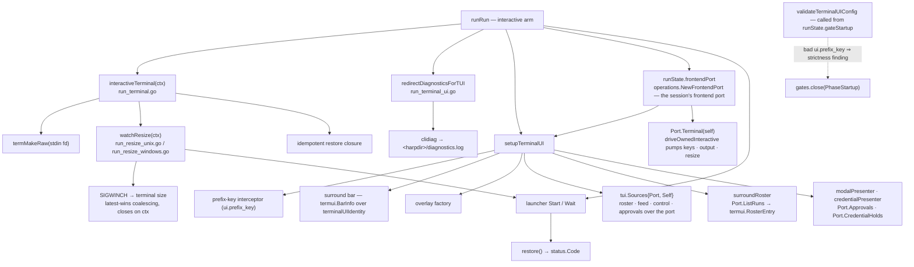
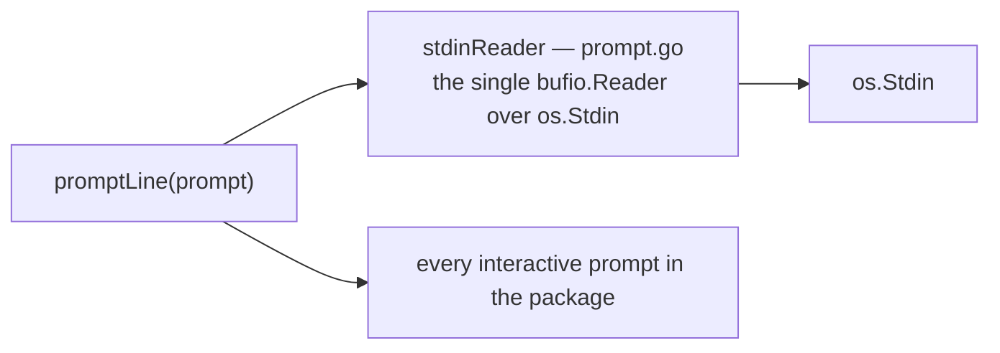

# Terminal ownership, the run UI, and interactive prompts

Two separate concerns share this page because they share one resource: the
process's terminal. The first is `ctxloom run`'s terminal *ownership* — raw
mode, resize relaying, the prefix-key interceptor and surround status bar, and
diagnostics redirection so warnings do not scribble over an engine's TUI. The
second is the package-wide *prompting* primitive: one buffered reader over
stdin, shared by every y/N question in the CLI, plus the terminal predicates
that decide whether prompting is legal at all.

## Terminal ownership during a run

- `interactiveTerminal` makes the frontend the terminal owner: it puts the
  real terminal in raw mode so keystrokes pass through untouched to the
  runner's pty, returns `os.Stdin` as the keystroke source plus a resize
  channel, and a restore func that switches off the terminal modes an engine
  may have left on (`terminalModeReset`: focus reporting, bracketed paste,
  every mouse mode, and the cursor shown again, written to stdout when it is a
  terminal) and then undoes raw mode. Each reset is a no-op on a mode the
  engine never set; the alternate screen is not reset. The restore is
  idempotent, so callers defer it immediately (panic safety) and may also
  call it inline before any normal-path output. When stdin is not a terminal
  it returns `(nil, nil, no-op)` and the run proceeds without a pty owner; a
  raw-mode failure on a real terminal warns that the session will not receive
  keystrokes.
- `watchResize` emits the initial size, then one per SIGWINCH, latest-wins,
  and closes the channel on ctx cancel; the Windows build-tagged counterpart
  emits one size and closes.
- `validateTerminalUIConfig` parses `ui.prefix_key`; a bad value records a
  **fatal-class** strictness finding, consumed when `runState.gateStartup`
  closes the startup phase — before anything is spawned. `setupTerminalUI`
  builds the interceptor / surround bar / overlay factory; a bad key there
  only warns and returns nil, reachable only under `--degraded` because the
  gate already aborted otherwise.
- `terminalUIIdentity` is what the surround bar displays. Everything the bar,
  the overlay and the presenters show or do rides the session's frontend port
  (`runState.frontendPort`, [core/frontend-port.md](../core/frontend-port.md)):
  the overlay gets `tui.Sources{Port, Self}`, `surroundRoster` adapts the port's
  `ListRuns` to `termui.RosterEntry`, the approval modal presents
  `Port.Approvals()` and the credential notice polls `Port.CredentialHolds`.
  None of them holds the coordinator (`TestArch_FrontendsHoldNoCoordinator`).
- The modal is the approval queue's only presenter, so a run that does not
  build this layer cannot present approvals, and marks its queue unattended
  (`markUnattended`, over `coord.ApprovalQueue.Unattended`): `hostCoordinator`
  for a one-shot owner, `prepareSessionIO` when no terminal layer engages
  (`--plain-terminal`, no tty, an unparseable prefix key). The queue then
  refuses every request no grant covers at once, at every depth, naming why
  and the remedy (`unattendedReason`): a permission rule, or the posture that
  asks nobody, named for every shipped engine in its own words, since the
  asker may be a child on an engine other than the root's. The startup
  warnings (`runState.warnPosture`) predict the same outcome from the same
  facts (`presentsApprovals`) before either has happened.
- `driveOwnedInteractive` (`run_pty.go`) attaches the session's terminal through
  `Port.Terminal(activeHarp)` — the run's pty — and pumps the wrapped stdin into
  it, its output to stdout, and each resize onto it.
- `redirectDiagnosticsForTUI` diverts `clidiag` warnings to
  `<harpdir>/diagnostics.log` and returns a restore func. It is installed
  only for interactive runs that own a terminal and did not pass
  `--plain-terminal`.
- `shutdownSignals` (`signals_unix.go` / `signals_windows.go`) is the
  build-tagged signal set every long-lived command's `signal.NotifyContext`
  uses.

`--plain-terminal` disables the whole ctxloom terminal layer — the prefix-key
viewer and the surround bar — for one session.

## The stdin invariant

`stdinReader` is the single buffered reader over `os.Stdin`, shared by every
interactive prompt. A fresh `bufio.Reader` per prompt would silently
discard any bytes a previous reader buffered past its line, so all prompts
read through this one reader. `promptLine` and `plural` live in
`prompt.go` as cross-command primitives.

`init.go`'s setup interview has a structurally different reader: `initPrompts`
wraps an injectable `io.Reader`. Its constructor `newInitPromptsFrom`
additionally puts the **process-global** terminal into raw mode even when
built over an arbitrary reader, so the "injectable reader" seam does not
fully isolate from a real tty.

## The split view (built, not yet wired)

The split view replaces the surround bar and the summoned overlay with one
compositor: the agent tree on the left, the selected agent's view on the right.
It exists and is tested, but `ctxloom run` still drives `setupTerminalUI`; the
pieces below are not on the run path yet.

- **`internal/adapters/termemu`** is the one VT emulator seam. `termemu.Terminal`
  is the interface; `termemu.NewXVT` implements it over charmbracelet/x/vt. It
  commits a `termemu.Frame` at synchronized-output boundaries and reports the
  child's title, bell, OSC 52 clipboard and mouse mode through
  `termemu.Callbacks`. Only adapters import it: the layering rule keeps core and
  shared free of it, as it does termui and cli/tui.
- **`tui.Split`** (the bubbletea model) and **`tui.SplitView`** (`tui.StartSplit`)
  compose the screen. The left panel is the roster from the frontend port
  (`WatchRuns`, re-read with `ListRuns` on each event), with a token gauge and an
  activity glyph per row; it folds a subtree on Enter and collapses to a glyph
  column on a narrow terminal. The right pane is the root's emulated terminal,
  each row serialized once from the emulator, or, for a selected child, that
  child's event feed plus a line that sends `agent_send` (or `agent_steer` to
  interrupt). `ui.prefix_key` toggles focus between list and pane; every other
  key goes to the pane.
- **Approvals keep their focus locks**: a keystroke typed for the engine never
  answers an approval (`tui.SplitView` re-homes `PresentPolicy`).
- **`internal/testsupport/termoracle`** is the root terminal surface's contract
  (prefix-key encodings, the input token corpus, the summon contract). Today's
  termui and `tui.Split` both pass it, so wiring the split view in cannot quietly
  drop a behaviour the run depends on.

Wiring it in means `setupTerminalUI` gives way to a split-view setup, the
approval and credential presenters move onto `tui.SplitView`, and termui and the
overlay are deleted. One question decides it first: inside an emulated pane,
claude's pinned classic renderer scrolls its history into the emulator, where
neither the pane nor the terminal's own scrollback shows it.

## Terminal predicates

`terminal.go` defines `isInteractiveTerminal` (stdin *and* stdout are
terminals — the gate every `-i` surface checks), `stdinIsPiped`,
`stderrIsTerminal` and `stdoutIsTerminal`. `isInteractiveTerminal` is a
package variable so tests can substitute it.

## Invariants

- **One reader over stdin.** See above.
- **Restore is idempotent and always registered.** `interactiveTerminal`
  returns a restore closure the caller defers.
- **The prefix key is validated before anything spawns.**
  `validateTerminalUIConfig` runs inside `runState.gateStartup`, ahead of the
  startup gate closing, so a malformed `ui.prefix_key` aborts the launch rather
  than silently disabling the viewer mid-session.
- **Pointer identity, not file descriptor, decides paging.** `shouldPage`
  (`pager.go`) requires `out == os.Stdout` *and* `stdoutIsTerminal()`; a
  redirected writer is never paged even if stdout happens to still be a tty.
- **Diagnostics redirection is interactive-only.** `clidiag` warnings go to a
  per-harp log only when the run owns a terminal and `--plain-terminal` is
  not set.
