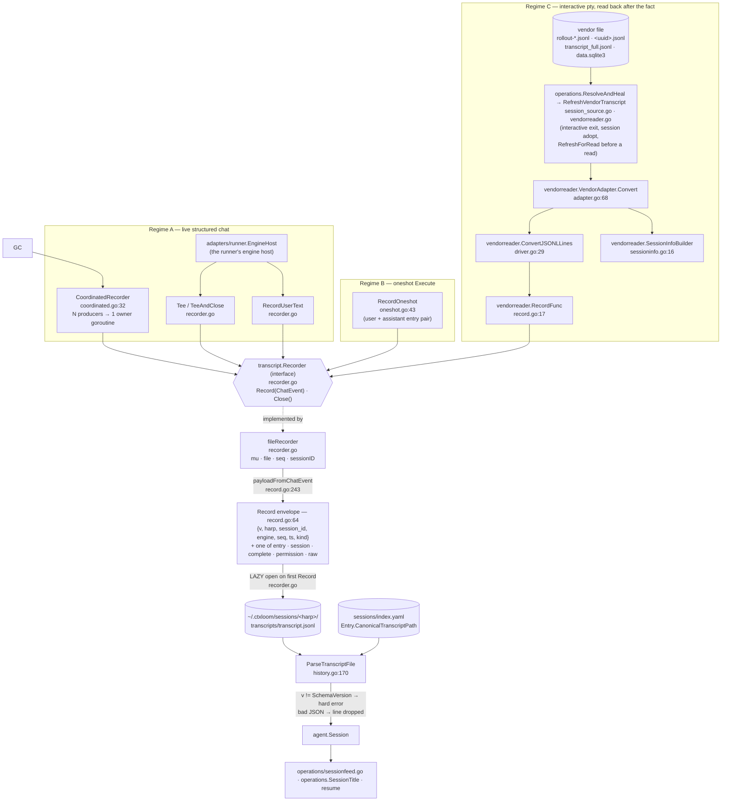
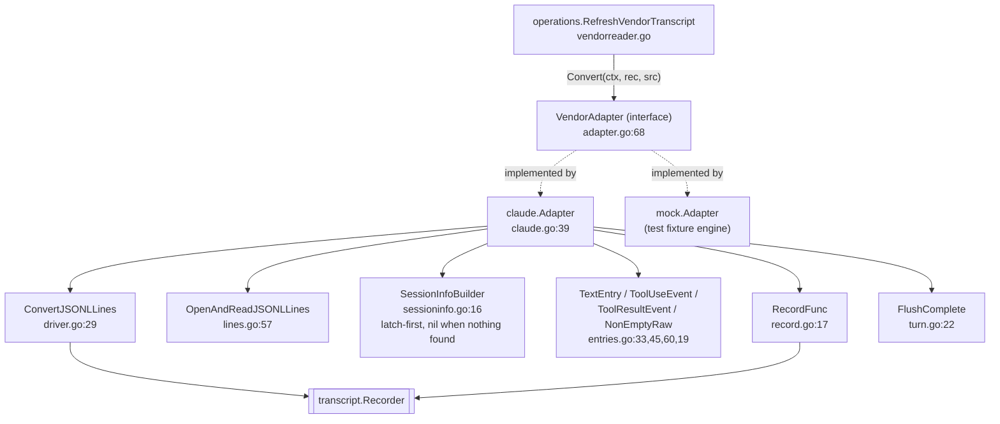

# `internal/adapters/transcript` — canonical conversation capture

**What it is.** `internal/adapters/transcript` owns ctxloom's **own** record of a conversation: a
versioned, append-only JSONL envelope schema, the writer that stamps it, and the reader that
turns the file back into an `agent.Session`. `internal/adapters/transcript/vendorreader` and its
per-engine adapters convert a **vendor-native** transcript into the same
canonical stream through the same writer.

**The contract it owns.** *One harp, one engine, one append-only file at
`~/.ctxloom/sessions/<harp>/transcripts/transcript.jsonl`, whose every line is a schema-versioned
`Record` with a monotonic `seq`.* It replaces the deleted per-engine transcript scrapers, so it
is the **only** memory source for the registered engine.

Two capture regimes exist because two things can drive an engine: a **live structured stream**
(the host tees `agent.ChatEvent`s through a `Recorder`) and an **interactive pty** (a human
driving the vendor's own TUI produces no event stream at all, so the vendor's file is read back
after the fact).

---

## 1. The capture path

**The two things to hold in mind:**

1. **The file is opened lazily, on the first successful `Record`** (`recorder.go`). A
   conversion or chat that produces zero events therefore leaves **no file at all** — this is
   deliberate, so that "file absent" means "nothing was ever recorded" rather than "a zero-byte
   file exists". `NewRecorder` only validates and resolves the path.
2. **Nothing trusts an existing canonical file as complete.** `operations.RefreshVendorTranscript`
   rebuilds it from the vendor source on every call, writing through a temporary sibling that is
   renamed into place only on success, so a failed or empty conversion leaves the harp exactly as
   it was. That is what lets the readers that show or resume a session refresh first
   (`operations.RefreshForRead`): a session whose run did not exit through ctxloom is read as its
   engine's log has it now, and a failed refresh costs the read nothing.

---

## 2. The envelope

| Symbol | file:line | Notes |
|---|---|---|
| `SchemaVersion` | `record.go` (const) | Stamped into every line's `v`; `ParseTranscriptFile` **hard-errors** the whole file on a mismatch (`history.go:185-187`) |
| `Kind` | `record.go:35` | `entry \| session \| complete \| permission \| raw` — the discriminator selecting which of `Record`'s five payload slots is populated. Mirrored exactly in `docs/transcript.schema.json`'s `kind` enum |
| `Record` | `record.go:64` | `{V, Harp, SessionID, Engine, Seq, TS, Kind}` + `Entry`/`Session`/`Complete`/`Permission`/`Raw`. One instance == one JSONL line |
| `EntryPayload` | `record.go:121` | On-disk mirror of `agent.SessionEntry` (15 fields) |
| `ToolLocation` / `ContentBlock` / `ToolContentBlock` / `PlanEntry` | `record.go:147`,`:153`,`:160`,`:171` | Leaf mirrors |
| `SessionPayload` | `record.go:179` | Mirror of `agent.ChatSessionInfo` — carries Model / PermissionMode / ContextWindow. **Does not carry `Resumable`** (`agent/chat.go:477`), which `coord/enginehost.go:387` reads for the resume gate |
| `MCPStatus` | `record.go:188` | |
| `CompletePayload` | `record.go:197` | Mirror of `agent.TurnMeta`, all 11 fields |
| `PermissionPayload` | `record.go:213` | Mirror of `agent.PermissionRequest`. **Does not carry `ToolCallID`** (`agent/chat.go:371`), so a recorded permission request cannot be re-paired with its tool call |
| `PermissionOption` | `record.go:228` | |
| `RawPolicy` | `record.go:269` | `off \| lossy-only \| all`, applied by `fileRecorder.rawToPersist` (`recorder.go`) |

**Why the mirrors exist.** `agent.SessionEntry` & co. carry **no json tags**
(`internal/core/agent/backend.go`, `chat.go`), so marshalling the in-memory types directly
would make the on-disk format hostage to Go field renames. That is a legitimate schema boundary.
The cost is **four hand-edited sites per field** (agent type → payload struct → to-payload
converter at `record.go:308-414` → from-payload converter at `history.go:239-285`) with nothing
enforcing parity. `record.go:9-12` claims the payloads mirror `agent.ChatEvent` "field-for-field";
`Resumable` and `ToolCallID` are the two places that is currently false.

---

## 3. Writers

| Symbol | file:line | Notes |
|---|---|---|
| `Recorder` (interface) | `recorder.go` | `Record(agent.ChatEvent) error` + `Close() error`. The seam every capture path shares; `vendorreader.VendorAdapter` takes it as a parameter |
| `NewRecorder(fs afero.Fs, harp, engine string, opts ...RecorderOption)` | `recorder.go` | Requires a non-nil `fs` (every write goes through it) and a non-empty harp + engine, resolves the path via `paths.HarpCanonicalTranscriptPath`, applies options. **Does not open the file** |
| `RecorderOption` (the `With*` constructors) | `recorder.go` | No production caller passes `WithRawPolicy` — so in production the policy is always `DefaultRawPolicy`. `WithWriter` sends a recorder's lines to a caller-owned writer instead of the default canonical path, so no file is opened and no ownership lock is taken |
| `fileRecorder.Record` | `recorder.go` | Classifies via `payloadFromChatEvent`, stamps the envelope, lazily creates dir + file, appends one line, bumps `seq`. Refuses a fully-zero `ChatEvent` |
| `fileRecorder.Close` | `recorder.go` | Idempotent (nil-guarded) |
| `RecordUserText` | `recorder.go` | The **only** path that captures user turns; called by the runner's engine host |
| `Tee` / `TeeAndClose` | `recorder.go` | Passthrough goroutine: `Record` then forward. `TeeAndClose` closes the recorder when the source drains — without it the fd leaks for process lifetime |
| `RecordOneshot` | `oneshot.go` | Writes a two-entry (user + assistant) transcript for a one-shot run, which emits no event stream. Called by the one-shot drive (`cli/run.go`, `cli/run_owned.go`) and `operations`' one-shots |
| `CoordinatedRecorder` | `coordinated.go` | Funnels N producers into one owner goroutine so `seq` order is a function of `Submit` arrival, not lock scheduling (a measured 79/80-record drop under the old lock-scheduled wiring) |
| `NewCoordinatedRecorder` / `ProducerDone` / `Submit` / `Done` | `coordinated.go:67`,`:92`,`:100`,`:115` | `recordRequest` (`coordinated.go:50`) carries an ack channel so `Submit` returns only after `Record` has *returned*, not after the channel handoff |

**Error handling on the live path.** Every `Record`/`Close` error is discarded with `_ =` by
the callers — `RecordUserText`, `Tee`, `TeeAndClose` and the coordinated recorder's owner
goroutine — so the chat never sees a capture failure. The `fileRecorder` itself surfaces them:
`noteFailure` counts each failed `Record` and warns (`clidiag`) on the first only, and `Close`
reports the lost-event total once.

---

## 4. Readers

| Symbol | file:line | Notes |
|---|---|---|
| `ParseTranscriptFile` | `history.go:170` | Streams the JSONL, version-checks each line, folds entries, computes the ts span. **Split contract:** a bad-JSON line is dropped silently (`history.go:183`); a `v` mismatch is a hard **file** error (`:185-187`) |
| `entriesFromRecord` | `history.go:215` | One `Record` → 0 or 1 `agent.SessionEntry` |

Every reader is handed `Entry.CanonicalTranscriptPath` from the session store, which
`sessions.fillCanonicalTranscript` fills by stat'ing `paths.HarpCanonicalTranscriptPath`.

**The version-mismatch contract has no teeth end to end.** The consumers swallow the hard
error: `operations/sessionfeed.go` warns and returns nil; the transcript watch (`watch.go`) warns on
**every poll tick, forever**, since a version error is permanent, and re-parses the whole file
on each tick — `ParseTranscriptFile` offers no incremental/tail API.

**Empty-file behaviour.** A zero-byte file, or one whose every line fails to parse, yields
`(Session{Entries: []}, nil)`. `GetSession`'s own doc (`history.go:66-70`) states it never returns an empty Session in that
situation; that holds only for an **absent** file.

---

## 5. The vendor-reader layer

### 5.1 The shared contract and primitives

All symbols are in `internal/adapters/transcript/vendorreader` unless qualified.

| Symbol | File | Notes |
|---|---|---|
| `VendorAdapter` | `adapter.go` | `Convert(ctx, fsys, rec transcript.Recorder, src string) error`. `src` is engine-specific: a file path for claude |
| `ConvertJSONLLines` | `driver.go` | The scan/stream/flush driver: record the up-front `Session` event if `info != nil`, then per line — ctx check, `dispatch(line)` — then `flush()` |
| `ReadJSONLLines` / `OpenAndReadJSONLLines` | `lines.go` | Unbounded `bufio.Reader` (deliberately not a capped `Scanner` — vendor lines run to tens of KB). Keeps a final line with no trailing newline. Wraps failures with the vendor prefix |
| `SessionInfoBuilder` | `sessioninfo.go` | Latches each `ChatSessionInfo` field on its **first non-zero value** and tracks `found`, so "no metadata anywhere" yields `nil` from `Build` rather than an all-zero struct |
| `RecordFunc` | `record.go` | Returns a closure wrapping `rec.Record` failures as `"<vendor>: record: %w"` |
| `TextEntry` | `entries.go` | Non-empty text → a one-element `[]ChatEvent`; **nil for empty text**, so a blank turn contributes nothing rather than a zero-length entry |
| `ToolUseEvent` / `ToolResultEvent` | `entries.go` | The canonical tool_use / tool_result shapes, named once |
| `NonEmptyRaw` | `entries.go` | Normalizes an empty `json.RawMessage` to nil |
| `JoinNonEmpty` / `JoinNonEmptyFunc` | `text.go` | Blank-line joins, filtering empties |
| `FlushComplete` | `turn.go` | Records a still-open turn boundary at EOF — "a boundary at end of file is real data, not something to drop". Clears `*pending` **before** `record` returns |

**What a conversion reports.** `Convert` returns **only `error`** — no count of records written,
lines seen, or lines skipped — so the floor against a silent-empty import lives in each adapter:
claude's `converter.checkFloor` turns zero entries out of a file holding user/assistant lines, or
out of a file whose lines are all malformed, into an error. One level up,
`operations.RefreshVendorTranscript`'s `converted` reports that a rebuild committed bytes:
`operations.commitRebuild` aborts a rebuild that wrote nothing and reports `converted=false`, or an
error when the harp's rotation lineage says there was a conversation to recover. Every live
caller reaches it through `operations.ResolveAndHeal` — the interactive-pty exit
(`cli.healVendorTranscriptOnExit`), `session adopt` (`cli.healAdopted`), and the readers that show
or resume a session through `operations.RefreshForRead` (`RecordedSessionEntries` behind `run
--session` and the ended-child resume — a `run --session --dry-run` reads the copy as captured
through `CapturedSessionEntries` and writes nothing, `session show`, `session transcript show`, and `session
list`/`search` for a row with no title) — and each acts on `HealErr` only: the exit and the readers warn and go on with the copy
the harp has, `adopt` returns it. For a purged session `ResolveAndHeal` is its re-capture: a
rebuild that commits a canonical transcript clears the purge mark (`sessions.Store.ClearPurged`),
and one that rebuilds nothing or fails leaves it. Only the exit and `adopt` re-capture a purged
session; `RefreshForRead` never refreshes one, and `session adopt --yes` rebuilds one even when it
adopts no earlier log.

### 5.2 Per-engine adapters

| Adapter | Source shape | Discrimination | Notable decisions |
|---|---|---|---|
| **claude** (`claude.go`, `session.go`) | `~/.claude/projects/<slug>/<uuid>.jsonl`, flat records with a top-level `type` | `line.Type` (`session.go:23`) → `user` / `assistant`, 15 enumerated administrative types dropped; `contentBlock.Type` (`:86`) → text / thinking / tool_use / tool_result | `decodeContentBlocks` (`:124`) normalizes the dual-shaped `content` field (bare string \| array). Turn boundaries detected on `message.id` change (`handleAssistant`, `:249`). `isSidechain` is stamped onto every entry (`recordAll`, `:279`). `message.Role` is decoded and never read — the role comes from `line.Type` |

### 5.3 The class-wide silent-empty shape

Every adapter can return `nil` having recorded zero conversational entries, and the routes are
structurally the same in each:

1. **empty / all-blank source** — the line reader returns `(nil, nil)`, the loop runs zero times;
2. **every line malformed** — each `dispatch` skips the line per the documented skip-don't-abort
   contract;
3. **discriminator drift** — a renamed `type`/`status`/variant key matches no case and every line
   falls through;
4. **shape drift** — a renamed container field decodes to a zero value with no error, because
   `encoding/json` is used without `DisallowUnknownFields` and with no presence assertion on any
   required field.

For claude, `converter.checkFloor` closes routes 2 and 4 wherever the file holds user/assistant
lines: zero entries from such a file, or from an all-malformed one, is an error rather than a
success. Route 3 is reported, not refused: a line type the adapter has never heard of is counted, and
`converter.reportDrops` warns naming every such type. Route 1, and a file of nothing but administrative lines, stays
a legitimate empty success.

**No partial import survives.** `ConvertJSONLLines` records the `Session` event *before* its first
`ctx.Err()` check, so a conversion that fails — even on an already-cancelled context — has
written at least that line. None of it reaches the canonical path: `operations.RefreshVendorTranscript`
converts into a temporary sibling (`operations.newRebuildFile`) and `operations.commitRebuild`
renames it into place only when the whole rebuild succeeded with bytes, aborting it otherwise. A
failed first conversion therefore leaves no canonical file, a failed rebuild leaves the previous
one byte-identical, and the next call simply converts again.

---

## 6. Invariants

**Hold:**

1. **One `Recorder` instance == one harp + one engine.** `NewRecorder` rejects an empty harp or
   engine.
2. **`seq` is monotonic within a file** and is the truncation-detection signal readers are told to
   trust (`record.go:87-90`). A write that delivers part of a line
   still advances `seq` past the lost record (`fileRecorder.salvagePartialLine`), so the loss reads as a
   seq discontinuity rather than a reused seq.
3. **A zero-value `ChatEvent` is refused** — `payloadFromChatEvent` (`record.go:243`) errors and
   names every nil field, so no empty line is ever written.
4. **No events ⇒ no file.** Lazy open (`recorder.go`) means "file absent" is distinguishable
   from "captured empty".
5. **A schema-version mismatch is a whole-file error**, not a per-line skip (`history.go:185-187`).
6. **The caller owns `Recorder` construction and `Close`** — every `VendorAdapter` doc states it
   and no adapter closes the recorder it was handed.
7. **A malformed vendor line is skipped, never fatal**; only a structural failure (open/read, ctx
   cancel, `rec.Record` failure) aborts a conversion (`adapter.go` contract).
8. **`SessionInfoBuilder` latches first-wins and returns nil when nothing was observed**
   (`sessioninfo.go:57`), so an all-zero `ChatSessionInfo` is never emitted as if meaningful.
9. **`CoordinatedRecorder` requires `producers` to equal the number of `ProducerDone` calls, and
   no `Submit` after the last one.** Neither is enforced; violating the latter panics on a closed
   channel inside the live chat's goroutine.

**Do not hold, or are narrower than documented:**

- **"The payloads mirror `agent.ChatEvent` field-for-field"** (`record.go:9-12`) —
  `SessionPayload` drops `Resumable`, `PermissionPayload` drops `ToolCallID`.
- **`GetSession` "returns an error, not an empty Session"** (`history.go:66-70`) — true for an
  absent file, not for a zero-byte or all-corrupt one.
- **`Tee` "never blocks"** (`recorder.go`) — the goroutine blocks unboundedly on `out <- ev`
  with no context; an abandoned consumer leaks the goroutine and, via `TeeAndClose`, the open fd.
- **`NonEmptyRaw`'s stated rationale** (`entries.go:9-18`) — an empty non-nil `json.RawMessage`
  does not round-trip to a literal `null`. With `omitempty` (which `record.go:127` has) it is
  omitted; without it, `json.Marshal` **errors**. The function is still correct normalization; the
  reason given for it is not.
- **`vendorreader/adapter.go:9` still names the on-disk file `transcript.acp.jsonl`**, the pre-rename
  leaf; the fixtures under `internal/adapters/transcript/testdata/fixtures/` carry the same stale suffix.
- **`RawPolicy` is unreachable in production** — no production caller passes `WithRawPolicy`,
  so `RawOff`/`RawAll` are test-only constants and the default `RawLossyOnly` always applies.

---

## 7. Where this subsystem meets others

- **`internal/core/sessions`** fills `Entry.CanonicalTranscriptPath` (`sessions.fillCanonicalTranscript`,
  stat'ing `paths.HarpCanonicalTranscriptPath`); every reader hands that path to `ParseTranscriptFile`.
- **`internal/adapters/operations/vendorreader*.go`** owns adapter registration, locator discovery,
  and the canonical rebuild (`RefreshVendorTranscript`: the ownership probe, the watermark resume,
  the temp-then-rename commit) — every consequence of "the vendor reader cannot report a count"
  surfaces there, not here.
- **`internal/adapters/operations`** reads the canonical transcript directly through
  `ParseTranscriptFile`: a session's title (`SessionTitle`), resume (`RecordedSessionEntries`).
- **`internal/adapters/runner`** owns the live producer (the engine host's `CoordinatedRecorder`
  wiring).
