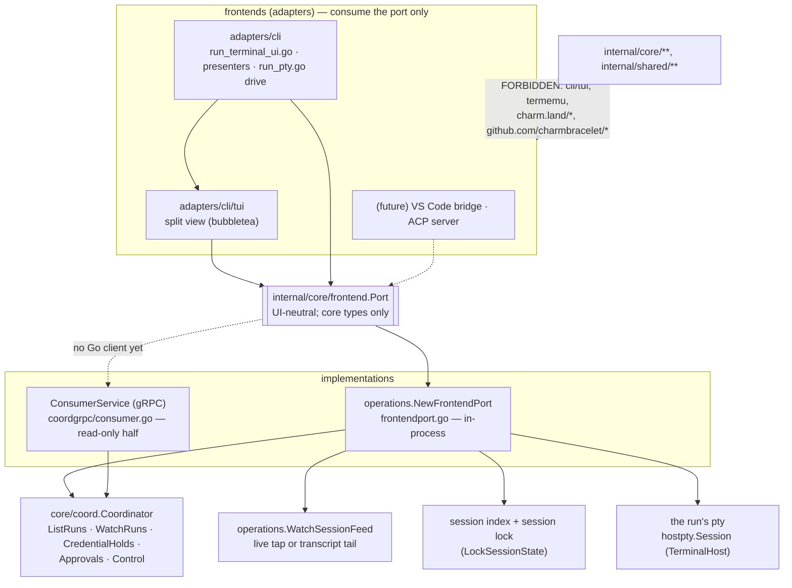
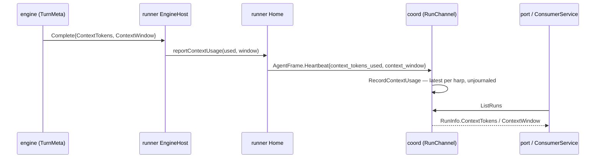

# The frontend port

`internal/core/frontend` is the ONE UI-neutral surface every frontend consumes.
The terminal UI (the `adapters/cli/tui` split view and `ctxloom run`'s own
terminal drive) is the first frontend; a VS Code bridge and an ACP server are expected. Every frontend gets
everything from the port, and core never knows which frontend is attached.
Ruled by the human 2026-10-13 (split-agent-view plan, session lone-shiny-mummy);
step 2 of task `vengeful-scrubber`.

The port is **ConsumerService's Go face, grown rather than paralleled**: where an
RPC exists, the port method carries its name and meaning (`ListRuns`, `WatchRuns`,
`CredentialHolds`), and the in-process implementation projects the same coordinator
state the wire does. What the port carries beyond observation — answering
approvals, the control verbs, the interactive terminal — is in-process only: see
[What is not on the wire](#what-is-not-on-the-wire).

## Layering

`ctxloom run` composes the port once per session (`runState.frontendPort`,
`cli/run.go`) and hands that one value to the split view (`tui.SplitOptions.Port`:
its tree, a child's feed, the control verbs), the approval presenter
(`modalPresenter` over `Port.Approvals`), the credential notice
(`credentialPresenter` over `Port.CredentialHolds`), and the interactive drive
(`driveOwnedInteractive` takes `Port.Terminal`, which the split view writes
keystrokes and resizes to and whose output the drive copies into its pane). None of them holds the coordinator.

## The contract, by symbol

| Method | What a frontend observes or does | In-process implementation | On ConsumerService |
| --- | --- | --- | --- |
| `ListSessions` | the project's session index, newest first, each with its session lock's verdict (`SessionLive` / `SessionEnded` / `SessionUnknown`) — the roster's backdrop | `ListSessionsForProject` + `LockSessionState` per row | no RPC (the index is files any process reads) |
| `ListRuns` | every run the coordinator holds, ended ones included: harp, agent, parent harp, state, last activity, hold, terminal cause, unread mail, **context tokens / window** | `Coordinator.ListRuns(true, "")` | `ListRuns` |
| `WatchRuns` | one roster snapshot, then every live event from that instant until ctx ends (Events then closes); a too-slow subscriber gets an `EventsLost` marker, never a silent drop | `Coordinator.WatchRuns`, forwarded and closed on ctx | `WatchRuns` |
| `WatchFeed` | one agent's feed: entries and gaps, live while the coordinator holds it, else the transcript's tail | `WatchSessionFeed`, boundaries and heartbeats dropped (`frontendFeedEvent`) | via `WatchRuns` + the transcript store |
| `CredentialHolds` | every turn-failure hold in force — rate limit, refused credential, overload, unreachable endpoint — oldest first; carrier **names** only | `Coordinator.CredentialHolds` | `CredentialHolds` (new) |
| `Approvals` | the root's approval queue: pending requests (asker, lineage, tool, deadline), arrival/resolution subscription, the one place a request is answered (allow once, allow for the session with rules, a posture change, deny with a message), the session grants an allow left and their revocation; nil when none | `Coordinator.Approvals()` (`coord.ApprovalSource`) | `PendingApprovals` only (read-only, no id) |
| `Control` | the human initiator's verbs on any held run: **steer** is the human's send (durable mail the target takes at its next turn), steer with `Interrupt` cuts the turn in flight and is its next turn now; question, summarize, pause, resume | `Coordinator.Control(InitiatorHuman, …)` | none |
| `Roster` | the agent list as a frontend shows it, arranged under a `RosterQuery` (self, selection, status filter, age window): index and runs merged into one lineage tree (`BuildRoster`), each row's waiting approvals, waiting rows first in their level, only the rows the filters pass, the self/selection/parents they keep marked `Context`, and how many they hide | `ComposeRoster` over the port's own `ListSessions` · `ListRuns` · `Approvals` | none (computable from `ListRuns` and the index) |
| `Terminal` | the session's own interactive terminal: read the engine's output, type into it, `Resize`; every other run is headless (`ErrNoTerminal`) | the run's pty master and `Resize` | none (bytes never travel over gRPC) |

Errors a frontend branches on: `frontend.ErrNoTerminal`, `frontend.ErrNoCoordinator`
(`WatchRuns` in a session hosting no coordinator), `coord.ErrNotInjectable` (control
of a harp no coordinator holds, including when none is hosted),
`coord.ErrApprovalResolved` / `ErrNoSuchApproval` / `ErrNoSuchGrant`.

### Context usage (tokens)

`TurnMeta.ContextTokens` is what was in context at the turn's last model call —
uncached input, cache reads and cache writes together. It is not `InputTokens`, the
uncached part alone: claude serves nearly the whole conversation from its cache, so
that part is a handful of tokens. claude reads it off the result frame's last
`usage.iterations` entry; opencode off its last step's tokens.

The gauge is a gauge, not state: no fact journals it, so a restarted coordinator
shows none for a harp until that harp's next turn. It is keyed by harp because a
harp driven one run per turn is still one conversation.

## The roster

The agent list is decided once, below every frontend, in `internal/core/frontend`
(`roster.go`): `BuildRoster` merges the index and the runs into the lineage tree, and
`ArrangeRoster` orders and filters it for display — the status filter
(`StatusFilter`: all · active · waiting · ended) and the age window (`ui.list_window`,
read by `operations.ParseListWindow`, an adapter since it reads config; `NextListWindow` steps 1h · 1d · 7d · any age). A row the
window would hide still shows while it matters now (running, waiting on an approval,
holding mail, held); the running session and the selection always show, as does the
parent of every row that shows, marked `RosterRow.Context`. `Port.Roster` is
`ComposeRoster` over the port; the terminal UI keeps the merged rows it last read and
re-arranges them with `ArrangeRoster` on each key, so a filter change costs no read. A
frontend draws the rows it is given and decides none of this.

## The contract tests

`internal/testsupport/frontendcontract` is the contract, written once:
`frontendcontract.Run(t, live, degraded)` asserts it against any implementation
given a `World` — a live session the suite can drive from outside the port
(delegate a child, have it ask the root, turn its next turn away, stop it).
`internal/testsupport/livecoord` is that world for real: a served coordinator whose
children are real in-process runners over a real RunChannel, driving a scripted
engine per child. `operations.TestFrontendPort_Contract` runs it against the
in-process port, with a real pty running an echo engine as the session's terminal;
`TestConsumerService_CarriesWhatThePortGrew` checks the grown wire fields over a
real gRPC dial. `frontendfake.Port` is the double a frontend's unit tests share.

## Enforcement

- **`core-and-shared-import-no-frontend`** (`archrules.LayeringRules`): no production
  file under `internal/core` or `internal/shared` imports `adapters/cli/tui`,
  `adapters/termemu`, or any `charm.land/*` / `github.com/charmbracelet/*` module.
  Third-party modules are named through `LayeringRule.ForbidModules`, matched by import
  path; `TestArch_LayeringForbidModules_NameRealModules` fails a prefix that matches no
  required module. Enforced by `just lint-arch` and the pre-commit hook.
- **`TestArch_FrontendsHoldNoCoordinator`** (`tests/arch`): no production file of
  `cli/tui`, or the CLI's terminal-UI and presenter files names
  `coord.Coordinator`.
- **`TestNoWirePathAnswersAnApproval`** (`coordgrpc`): ConsumerService is exactly its
  reviewed methods and no decision crosses the wire.

## What is not on the wire

ConsumerService authenticates with the coordinator's one **read-only** consumer
credential (`consumerCreds`, plaintext in the 0600 `endpoint.json`), and
`ApprovalSource.Answer` is reachable only in-process — that is what makes the root
human the only approver. So the port's action half (answer, revoke, control) and the
terminal are in-process only, and the gRPC side is not yet a full `Port`. Putting them
on the wire needs a decision on a credential class that may act, which step 2 left
open (see the task log).

## ACP mapping

Checked against the ACP schema the repo last vendored (`internal/acptest/acp-schema-v1.json`,
schema-v1 of `coder/acp-go-sdk`'s branch `schema-v1.19.0`, removed in `4cd0c977d`).
In ACP the editor is the client and ctxloom would be the agent; one ACP session
maps to one harp.

| Port surface | ACP | Fit |
| --- | --- | --- |
| `ListSessions` | `session/list` → `SessionInfo{sessionId, cwd, title, updatedAt}` | maps; liveness and engine ride `_meta` |
| `ListRuns` (roster, lineage, state, hold, unread) | none — ACP sessions are flat | **gap**: a child is its own ACP session; parent harp, state, hold and unread ride `_meta` or `session_info_update` |
| `ListRuns` context tokens / window | `session/update` `usage_update{used, size, cost}` | maps (push, not poll); cost is on `Usage` at run end, not per turn |
| `WatchRuns` live events | `session/update`: `agent_message_chunk`, `agent_thought_chunk`, `tool_call`, `tool_call_update`, `plan` | maps per event; the snapshot frame has no ACP counterpart; `EventsLost` has none |
| `WatchFeed` (transcript tail) | `session/load` replays history as `session/update` | maps |
| `CredentialHolds` | none | **gap**: no hold or rate-limit notion; nearest is `session_info_update` `_meta` or an agent message |
| `Approvals` pending + answer | `session/request_permission{toolCall, options}` → `selected optionId` / `cancelled` | maps one request at a time, agent → client; `allow_once`/`reject_once` map; `allow_always` ↔ a session grant |
| approval posture change (`SetMode`) | `session/set_mode`, `current_mode_update` | maps |
| `Grants` / `Revoke` | none | **gap**: ACP has no list of remembered decisions to revoke; `reject_always` has no ctxloom counterpart (no deny rules) |
| the pending queue as a list | none | **gap**: ACP pushes requests; it has no queue view |
| `Control` steer (send) | `session/prompt` | maps for the session's own turn; to a CHILD only if the child is its own ACP session |
| `Control` steer with `Interrupt` | `session/cancel` then `session/prompt` | maps |
| `Control` question / summarize / pause / resume | none | **gap**: at most `available_commands_update` slash commands |
| `Terminal` (attach to the engine's TUI) | none — ACP `terminal/*` are CLIENT methods the agent calls to run commands in the editor | **gap**: the opposite direction; an interactive pty session is not an ACP session at all |
| plan approval (child's plan, approved by its parent) | `plan` update is informational; claude-code-acp models plan exit as a permission request with mode options | not on the port (open decision) |
