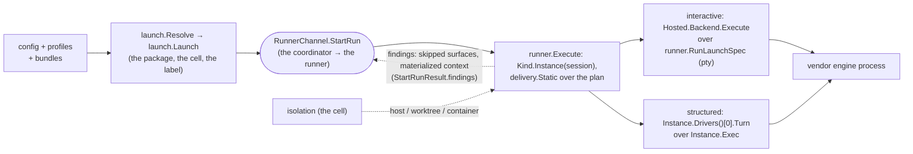

# Engine & launch layer

How ctxloom turns "run this agent" into a running vendor engine process. This
directory documents `internal/engines` (the composition root, the per-engine
packages and the conformance suite) and `internal/adapters/isolation` (the
isolation seam).

**The one architectural fact to carry into everything else**: ctxloom holds no
provider SDK and makes no direct model-API call. Every engine reaches its model by
spawning the **vendor's own binary**. This is a licensing invariant, not a style
preference, and it lives in the *shape* of every engine's `Instance.Exec`: an
argv for the vendor's binary, never an HTTP client.

## The definition / instance split

An engine is two halves on one port (`internal/core/engine`):

- **The DEFINITION — declarative, in `internal/core/engine`.** An engine KIND
  is a value: the engine package's struct embedding `engine.Base`, whose
  `Definition` declares one typed approach per surface kind (`Context`, `MCP`,
  `Settings`, `Hooks`, `Commands`, `Skills`), the optional `Dynamic` approach,
  the modes and their argv grammars (`CLI`, derived from the L1 `EngineCLI`),
  and the export schema; the engine's permission model rides beside it
  (`Engine.Permissions`). `Base` derives every view
  (`Surfaces`, `Carries`, `Static`), decides static-vs-dynamic delegation
  once (`Delegate`), and `Validate`s coherence in the ONE plain constructor
  each engine package exposes (`claude.Build`, `opencode.Build`,
  `mock.New`/`mock.Build`).
  `engines.Build()` composes the kinds into an `engine.Registry` value.
  `core/engine/conformance` asserts the declarative half for every kind;
  each engine package runs it against its own constructor.
- **The INSTANCE — what runs a session, on the port.** `Engine.Instance(Session)`
  binds one session and is where REQUIREDNESS is refused (a kind whose
  `Definition` lacks the context surface the session needs refuses it by
  name, `engine.ErrUnsupported`); `Instance.Exec(presented)` is the ONE
  place an engine's argv/env/cwd is composed — for claude, `buildArgs` and
  `Chat` are projections onto it and the launch golden
  (`engines/claude/testdata/exec_parity.golden`) pins every launch of the
  matrix byte-identical; `Instance.Drivers()` are the engine's native
  structured drivers (claude: a per-turn stream-json driver, opencode: a
  per-turn `opencode run --format json` driver, both assembled from
  `kit.ProcessTurn`; empty means
  pty-only and a Structured launch is refused with
  `ErrUnsupported{drive}`); `Instance.Resume(key)` re-attaches a native
  session. The engine's own stories are the kind's methods: `Home()`
  (`engine.HomeSpec`, the zero value the null object; `Vars` are the home
  vars isolation binds, every one of them, by `engine.BindHome`: the first names
  the session home, each further one a directory beneath it; `Auth` names the env
  var the engine reads its long-lived token from), `Container()` (a spec or a refusal),
  `Transcripts()` (readers the composition root hands in — they are
  transcript adapters an engine must not import) and `Hooks()` (the
  engine's hook wire, `engine.HookCodec`: `Decode` a native payload into a
  neutral `HookEvent`, `Encode` a neutral `HookResponse` into the native
  stdout and exit status, `ContextLimit`, and `InvokedSkill` — see
  [hooks](../cli/hooks.md#the-hook-codec)). `adapters/isolation` reads those facts off the engine
  (`isolation.FactsOf`), and `adapters/runner.Execute` binds the Instance
  before delivering. `core/engine/conformance` asserts both halves
  for every kind.
- **The composition root and the seam's remainder.** `engines.Compose()`
  builds the shipped kinds once per process (`engines.Registry()` is what
  every adapter that resolves an engine by name reads; `engines.Use` is the
  test seam; `isolation.RegistryFacts` is installed beside it by the root
  that composed). What `agent.Backend` still needs that the port does not
  carry — the backend constructor, the typed config, the named-form table a
  binding's `surfaces:` is validated against, the settings writer `manage
  status` reads, the project/global settings collision guard — is
  `agent.Hosted`, implemented by each engine VALUE and asserted on the
  registry's value (`engines.Hosted`); the L1 process-surface grammar the
  standalone mock impersonates is `agent.EngineCLIProvider` on the same
  value (`engines.EngineCLIs`). Both leave with `agent.Backend`. The
  structured drive is per turn (`Instance.Drivers()[0].Turn`); the
  interactive launch is the hosted engine's `Backend.Execute` over the
  runner's launcher (`runner.RunLaunchSpec`, a plain pty via
  `ptyrunner.RunInteractive`). The managed-hooks assembly is `operations/managedhooks`.

Outside INITIAL SETUP nothing names or chooses an engine: engine-specific
behaviour is reached only through the Definition, its approaches and its
declared capabilities, through the registry. Initial setup is defined by
structure, not by a list: the registry root (the package `internal/engines`,
the composition root) and each engine's own tree `internal/engines/<id>/**`
for a registered engine ID — so a shared package beside the engines, the
engine kit `internal/engines/kit`, is not setup and names no engine — every
`package main` (a binary's composition root), an
engine's family package (one whose last path element is a registered
engine's ID, such as `transcript/vendorreader/claude`), and a lean binary's
own engine registry (`internal/<bin>/engine`). `tests/arch`'s
`TestArch_EngineIdentity_OnlyInitialSetupNamesAnEngine`
(`engine_identity_arch_test.go`) holds it with no allowlist: outside that
set no production file imports a concrete engine package or spells a
registered engine name or ID, as a literal or as any constant expression
the gate can fold. A roster of engines is therefore always a DERIVED view
over the registry, filtered by what each Definition declares. The gate's
residual gaps (an identity built at run time; an identity check dressed as
a capability) are stated in its file doc.

## Shared engine components: `internal/engines/kit`

What every engine would otherwise write the same way lives once in
`internal/engines/kit`, as SHAPE with a hole for the engine's content: a
component takes the engine-specific part as a value (a func, a name, a line
mapper) and never branches on which engine it serves. Content (argv flags,
config dialects, renderers, failure tables) stays in each engine.

- **`kit.ProcessTurn`**: the per-turn subprocess driver, an
  `engine.StructuredDriver`. It opens the turn's process from the Exec
  (`kit.Spawn`: piped stdio, its own process group, interrupt then kill
  after `kit.DefaultInterruptGrace`), writes the prompt, reads stdout as
  lines through the engine's `kit.LineMapper` (`Map` per line, `End` once at
  stdout's end), relays every event, and classifies the turn: native key,
  answer (the last completion's text), denials joined across completions,
  the engine's own exit status, and `kit.ErrTurnProcessDied` for a process
  that ended with no completion and a failed exit. The engine supplies
  `Argv`, `WritePrompt`, `NewMapper` and optionally `Env`, the turn's own env
  over the Exec's (claude: `instance.turnArgv`, its NDJSON user message,
  `turnStream`, no `Env`; opencode: its run argv, the raw prompt, its JSON
  event mapper, and the turn's posture as `OPENCODE_PERMISSION`).
- **`kit.ComposeEnv`, `kit.PresentedArgs`**: the Exec composition every
  engine's `Instance.Exec` starts from: home vars at their bound paths then
  each presentation's env in delivery order; each presentation's argv in
  delivery order, with an optional per-presentation refusal (claude's
  untrusted-repository vetoes). claude, opencode and the mock use them.
- **`kit.Approach`**: the name and traits every typed approach embeds, and
  the one rooting rule (`Rooted`): the session-home rel or the project-root
  rel for the root the plan selected, a root the traits do not offer refused
  naming the engine and approach, and, when `Private`, a session home that
  was never rooted refused (`agent.SessionHomeRooted`). claude's and
  opencode's approaches are `Private`; the mock's are not.
- **`kit.AppendedSection`**: the context claimed as a section after a
  well-known file's own text (claude's project `CLAUDE.md`, the mock's
  `MOCK_CONTEXT.md`); the ownership record owns what is appended.
- **`kit.DeliverCommands`, `kit.DeliverSkills`**: the managed trees, written
  under the rooted directory through the shared writers
  (`agent.WriteManagedCommandFiles`, `agent.WriteManagedSkillPackages`, which
  skip a traversal or absolute name with a warning), every placed file
  declared. The engine supplies the command renderer (claude and opencode:
  frontmatter + `$N`; the mock: the body verbatim), the skills it accepts
  (claude and opencode: `kit.AgentSkillRules`; the mock: all) and an optional
  announce on its channel.
- **`kit.FramedFile`**: the framed context (`agent.FrameProjectContext`) as
  a whole file the approach owns under the session home, written keep-mode
  and declared; empty context writes and presents nothing. The engine
  supplies the leaf and the channel (claude: `kit.HashedName(".sysprompt.md")`
  on `--append-system-prompt-file`; opencode: `kit.FixedName("AGENTS.md")`
  on `OPENCODE_CONFIG_DIR`).
- **`kit.MCPTable`**: one engine's MCP server table — its top-level key and a
  per-server dialect func — claimed per server in name order through the
  bundle that shipped it, with an optional empty table (claude's private
  `.mcp.json` must exist; opencode's `/mcp` need not).
- **`kit.AgentSkillRules`, `kit.CheckAgentSkill`**: the Agent Skills
  frontmatter standard (name pattern, 64/1024 limits, required fields) with
  the engine's reserved words as a value (claude: `anthropic`, `claude`;
  opencode: none), refusing a failing enabled skill loudly.
- **`kit.ExportDecoder[T]`**: an engine's export block, schema-validated
  (compiled once) then decoded, a refusal naming the engine.
- **`kit.ProjectedBackend`**: `agent.Backend` as a projection onto the kind
  (every argv is `kind.Instance(session).Exec(presented)`) over
  `agent.LaunchBackend`; the engine supplies `kit.BackendDefaults` (binary,
  provider, home var, default policy, its typed config's binary/args).
- **`kit.ResolveDegraded`**: a permission model's `--degraded` fallback to
  its floor (the mock's and opencode's models).
- **`kit.HookEvents`**: an engine's unified⇄native hook event table
  (`Unified` maps a native or unified name back, `Map` routes a unified
  one to its native point); claude's codec and opencode's bridge. It lists
  only the broad events: a matcher-narrowed one (`pre_shell`,
  `post_file_edit`) rides its broad event's point, so the table is NOT a
  statement of what the engine carries — `Definition.HookLosses` is.
- **`kit.NativeHookCodec`**: `engine.HookCodec` over ctxloom's OWN hook wire
  (`kit.NativeHookPayload` on stdin, `kit.NativeHookAnswer` on stdout), for
  an engine whose hooks ctxloom fires itself; the engine supplies its event
  table, its skill and edited-path readers, and the events an answer may
  carry context or a block on. The mock's codec and opencode's.
- **`kit.SocketWake`**: a `WakeSpec` over a unix socket the interactive
  session's runtime listens on (`Path` is the socket in the session's short
  socket root, `engine.Session.SocketRoot`, named in the engine's own env
  var; `Fire` posts `engine.WakeText` as one line). The mock's and
  opencode's. The socket root is not the session home, which nests too deep
  for a unix socket path (sun_path: 108 bytes on linux, 104 on darwin): the
  runner computes it beside the engine (`launch.SocketRoot`) as
  `<base>/ctxloom-<16 hex of the session home's sha256>`, the base being the
  first of `$XDG_RUNTIME_DIR`, the temp dir and `/tmp` that leaves room
  within `engine.SocketPathBudget`. `Ensure` makes it owner-only (refusing a
  link) before the engine starts, and `ReleaseSocketRoot` removes it, when
  empty, after the engine ends.

**The kit rule: a component enters `internal/engines/kit` only when two
engines use it in the same slice.** A component with one user is that
engine's code, however generic it looks. kit imports no engine (layering
rule `enginekit-imports-no-engine`, enforced by archlint) and spells no
engine's name (`tests/arch`'s no-engine-name scan treats kit as a
non-home). Recorded exception: `kit.ProcessTurn` entered with claude as its
only user, ahead of the opencode runner that is its second; the owner
approved that slice (opencode-seams plan, S1) before the rule was written
down, and the opencode runner now uses it. The mock's driver is in-process
and does not spawn, so it is not a second user.

## The opencode kind

`internal/engines/opencode` drives the opencode CLI on the model a
`type: opencode` label names (opt-in), on one of opencode's built-in providers
or against an OpenAI-compatible endpoint (below): the TUI
on ctxloom's pty, and the structured runner. Everything is delivered into
the session home H, which `OPENCODE_CONFIG_DIR` names: the framed
`AGENTS.md`, `opencode.json` claims (`/mcp/<server>`, `/permission/<tool>`,
`/$schema`), `commands/`, `skills/` and `plugins/ctxloom.js`. Its home
relocates every path opencode reads: the
four XDG bases are further home vars merged with opencode's own app dir
owned (`.xdg/data`, ...), `OPENCODE_TEST_HOME` and
`OPENCODE_TEST_MANAGED_CONFIG_DIR` point at session dirs, and its database
is native history at `.xdg/data/opencode`, so a resumed child (`run
--session`) survives the disposable home. `Instance.Exec` composes
`OPENCODE_CONFIG_CONTENT` from the label (provider, `limit.context` from the
neutral `context_window`, timeouts, model options, snapshot/title/share) and
names the endpoint key only by reference; the key itself
(`CTXLOOM_OPENCODE_API_KEY`) rides the run's credentials (a secret file in a
container). A label with no `provider.base_url` names one of opencode's
BUILT-IN providers instead: its model (`opencode/big-pickle`) passes through
verbatim as `--model` and `model`, and no ctxloom provider block or
`enabled_providers` is written. The key is therefore optional: `opencodeAuth`
sets it when exported and otherwise authenticates keyless, because Auth never
sees the label and cannot tell an endpoint label from a built-in one. An
endpoint label run without the key reaches its endpoint with an empty key. The Exec
also sets `PWD` to the session's working directory: `opencode run` takes its
project directory from `$PWD`, not from its process cwd, so an inherited PWD
(the launching shell's) would put the agent outside a worktree checkout.

opencode runs no hook command, only in-process plugins, so its hooks
approach writes ONE generated plugin, the bridge (`plugins/ctxloom.js`,
from `bridge.js` with the bound hook set spliced in). On
`tool.execute.before` (pre_tool; pre_shell narrowed to its tool class) it
fires THE HOOK WIRE, ctxloom's cross-engine command-hook wire (ruling #28):
claude's PreToolUse input, the call normalised to claude's tool names and
input keys by one table (`claudeTools`; apply_patch keeps its own name, an
unlisted tool passes verbatim). The only reply it acts on is a deny with a
reason, which throws and fails the call; everything else passes. Every
matcher, a tool class's included, is tested against the claude name by
claude's matcher rule. Its other points carry `kit.NativeHookCodec`'s wire:
`tool.execute.after` (post tool; post_file_edit narrowed to its class; a
block throws, failing the call), `chat.message`
(turn_start: mail-drain's context becomes a synthetic part of the prompt,
a block refuses it), `session.created` (session_start, root sessions:
session-bind; its context joins the session's system prompt) and
`session.idle` (turn_end). session_end and permission_ask have no point
(`HookLosses`). The same plugin carries the TUI owner's wake (a unix socket,
`kit.SocketWake` on `CTXLOOM_OPENCODE_WAKE_SOCKET`: the wake's turn_start
hooks fire first, so a stale wake is never sent; otherwise the wake text is
`promptAsync`'d to the current root session, queued behind a busy turn) and
the transcript: after every turn, before the turn_end hooks,
`<data>/opencode/ctxloom/<session>.jsonl` (a header carrying the
session_start context — the harp marker — then each message as opencode's
API holds it), which is native history found by location; the reader is a
VendorAdapter in `opencode/engine` sharing the live stream's part mapping,
and `TranscriptSession` is the file stem. Loading any plugin makes opencode
wait at startup on its OWN npm install into each config dir
(`@opencode-ai/plugin`); an offline host sees opencode's npm failure there.
That is opencode's behaviour, tolerated, not worked around. ltk guards
opencode through the bridge with its one adapter, claude's: the bridge's
pre-tool payload IS claude's PreToolUse. Approvals and trust
are declared absent or unsupported, each with its reason.

Its container story installs the pinned release tarball
(`OPENCODE_CLI_VERSION`) for the machine and libc, taken from the official
GitHub release as-is, and runs `opencode --version` as the gate. There is no
checksum step: upstream publishes no checksums and ctxloom adds none, so
integrity rests on GitHub's TLS and the release itself.

## Start here

| If you want to know… | Read |
|---|---|
| **"Does engine X support Y?"** | **[Capability matrix](capability-matrix.md)** — engine × capability, every cell sourced |
| What the `Backend` interface still is, and how engines are composed | [Backend abstraction & registry](backend-abstraction.md) |
| What "isolated" actually means, per axis and per engine | [Isolation](isolation.md) |

## Per-engine adapters

| Page | Backend id | Drive | `plan` enforced? | Notable |
|---|---|---|---|---|
| [claude](claude.md) | `claude-code` | vendor CLI | **yes** | The exercised default. Carries a native per-tool deny list, and its approaches declare an out-of-cwd form (`agent.OutOfCwd`) so a shared cwd is never written into |
| [opencode](#the-opencode-kind) | `opencode` | vendor CLI (TUI on the pty; `opencode run --format json` structured) | **yes** (`planDenies`: every edit and shell call) | Opt-in; a built-in provider (keyless `opencode/big-pickle`) or an OpenAI-compatible endpoint. Hooks ride one generated bridge plugin, whose pre-tool point speaks claude's PreToolUse. No page of its own yet: see the section above |
| [mockengine](mockengine.md) | *(not a backend)* | it *is* the engine | n/a | A fake vendor CLI that proves context delivery — and what a mock-only pass does not prove |

The in-process test doubles (`mock.Name` and its siblings, `mock.Doubles`) are
composed engines too; they have no page of their own and are described
alongside the composition in [Backend abstraction & registry](backend-abstraction.md).

## The shape of the launch path

The runner is the ONE unit on both cells: `ctxloom runner <engine>` hosts the
launch on the host or as a container's foreground, and the Launch it decodes
is the same value the originator resolved — there is no hand-written wire
projection of a managed config left to drift.

## Facts worth knowing before you read any source here

These are documented in full on the pages above; they are collected here because
each one contradicts what the surrounding code looks like it does.

1. ~~**An unprofiled backend's container inherits claude's credentials.**~~ — **RESOLVED `a6d9bd95`.** The `default:` arm of `engineContainerSpecFor` returned `resolveClaudeContainerAuth` for any unrecognized engine. It now fails closed, and `runtime: container-*` for an engine with no auth mapping is refused when the binding is *written*, not when it is launched. → [isolation](isolation.md)
2. **Isolating a shared cwd without a container requires `agent.OutOfCwd`.** claude-code's approaches declare it; a backend whose approaches lack it falls back to the loudly-warned well-known write, and concurrent per-agent isolation for it needs a worktree or a container cell. → [matrix §4](capability-matrix.md)
3. **No composed engine has a live transcript scraper.** `agent.Backend` carries no history accessor: canonical capture, written runner-side into `internal/adapters/transcript`, is the only transcript. → [matrix §6](capability-matrix.md)

## Scope

Covered here: `internal/engines` (the composition root), `internal/engines/conformance`,
`internal/engines/kit`, `internal/adapters/isolation`, `internal/engines/claude`,
`internal/engines/mock`.

Types shared with the rest of the system — `agent.Backend`, `agent.ManagedConfig`,
`agent.Declaration` — live in
`internal/core/agent` and are documented here from the launch layer's point of
view.

These pages record **behavior**, not verdicts. Defect triage lives in `FINDINGS.md`;
where behavior diverges from what a doc comment or interface implies, the divergence
is stated as a fact with a `file:line` and nothing more.
