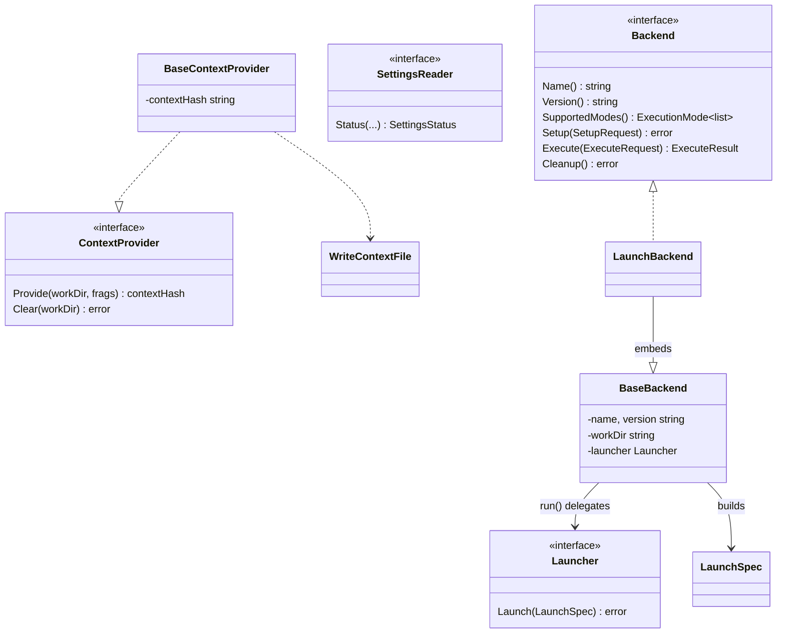

# agent — backend contract and base embeddables

`internal/core/agent` is the engine-agnostic substrate: it declares what every LLM backend must implement (`Backend`, `ContextProvider`, `SettingsReader`) and supplies the embeddable state every concrete engine reuses (`BaseBackend`, `BaseContextProvider`). It owns the process-launch seam (`Launcher`/`LaunchSpec`), so `os/exec` and pty handling stay outside this package. It sits at the bottom of the import graph — 26 internal packages import it and it imports only `internal/core/paths`, `internal/adapters/selfexec`, `internal/shared/{clidiag,collections,safefs,wire}`; nothing here reaches back up into config, bundles, or CLI.

## Core contracts

| Symbol | file:line | Purpose |
|---|---|---|
| `Backend` | `internal/core/agent/backend.go:65` | The runner-facing contract: identity, supported modes, and the Setup/Execute/Cleanup lifecycle. |
| `BackendConfig` | `internal/core/agent/backend.go:22` | One-method discriminator interface for a decoded per-backend config block. |
| `ContextProvider` | `internal/core/agent/backend.go:83` | Provide/Clear the assembled context; embedded by `HashedContext`. |
| `SettingsReader` | `internal/core/agent/settings.go` | Report what ctxloom has wired into an engine's settings files. Writes are claims through `delivery.Static`. |
| `Launcher` | `internal/core/agent/base.go:57` | The process-execution seam; the only thing that turns a `LaunchSpec` into a child process. |

## Request / result value types

| Symbol | file:line | Purpose |
|---|---|---|
| `ExecutionMode` | `internal/core/agent/backend.go:29` | interactive vs oneshot; values pinned `= 0` / `= 1` to mirror the proto enum. |
| `Fragment` | `internal/core/agent/backend.go:40` | One piece of injectable context (`Name`, `Version`, `Tags`, `Content`, `Installation`, `IsDistilled`, `DistilledBy`). |
| `ModelInfo` | `internal/core/agent/backend.go:51` | Provenance for the executed model (name/version/provider); populated by every backend's `Execute`. |
| `ManagedConfig` | `internal/core/agent/backend.go:348` | The host-assembled setup payload: `Commands`, `Skills`, `Hooks`, `MCP`, `BundleMCP`, `ManageStatusline`, `DenyTools`. |
| `ExecuteRequest` | `internal/core/agent/backend.go:366` | Runtime parameters for one execution. |
| `ExecuteResult` | `internal/core/agent/backend.go:400` | Outcome of one execution. |
| `LaunchSpec` | `internal/core/agent/base.go:15` | Fully-resolved process launch description handed to a `Launcher`; an interactive one names the `Terminal` the engine runs on. |
| `Terminal` | `internal/core/agent/base.go:36` | The runner's own stdio, which an interactive engine inherits as its stdin, stdout and stderr: no pty and no relay of the launcher's own. |
| `WindowSize` | `internal/core/agent/base.go:42` | A terminal size, as the frontend reads it off the human's terminal and applies it to the pty the engine is on. |
| `SettingsStatus` | `internal/core/agent/settings.go:61` | `{SettingsExists, HooksPresent, StatusLine, MCPPresent}` — which managed artifacts are wired. |

## Base embeddables

| Symbol | file:line | Purpose |
|---|---|---|
| `BaseBackend` | `internal/core/agent/base.go:61` | Embedded identity + launch state every concrete backend reuses. |
| `NewBaseBackend` | `internal/core/agent/base.go:75` | The constructor: name and version. |
| `BaseBackend.SetLauncher` | `internal/core/agent/base.go:70` | Injects the launcher. |
| `BaseBackend.Name` / `.Version` | `internal/core/agent/base.go:83` / `:88` | Identity getters satisfying `Backend`. |
| `BaseBackend.SupportedModes` | `internal/core/agent/base.go:93` | Returns both execution modes. |
| `BaseBackend.WorkDir` / `.SetWorkDir` | `internal/core/agent/base.go:98` / `:106` | Work-dir accessors; the getter defaults to `"."`. |
| `BaseBackend.BuildEnv` | `internal/core/agent/base.go:113` | `os.Environ()` + request env, appended in that order. |
| `BaseBackend.RunInteractive` / `.RunNonInteractive` | `internal/core/agent/base.go:123` / `:130` | Named entry points that call `run`, naming the binary to spawn, on a terminal / over pipes. |
| `BaseBackend.run` | `internal/core/agent/base.go:137` | Builds the `LaunchSpec` for the binary it is handed and calls the launcher; fails loud (exit 1) if no launcher was injected. |
| `BaseContextProvider` | `internal/core/agent/base_context.go:10` | Hash-keyed context-file lifecycle; the file's path reaches the launched engine as `CTXLOOM_CONTEXT_FILE`. |
| `NewBaseContextProvider` | `internal/core/agent/base_context.go:15` | Zero-value constructor. |
| `BaseContextProvider.Provide` | `internal/core/agent/base_context.go:20` | Writes the context file and records its hash. |
| `BaseContextProvider.Clear` | `internal/core/agent/base_context.go:30` | Removes the context file and clears the hash. |
| `BaseContextProvider.GetContextFilePath` | `internal/core/agent/base_context.go:45` | Recomputes the relative path from the hash. |

## Cross-cutting value types

| Symbol | file:line | Purpose |
|---|---|---|
| `GetPromptContent` | `internal/core/agent/base.go:168` | Nil-safe read of a prompt field; the nil guard is the whole point (7 call sites). |
| `IsManaged` | `internal/core/agent/predicate.go:13` | Ownership test — is this command line one ctxloom installed, by exec-token identity. |

## Invariants and contracts

- **Setup → Execute → Cleanup.** `Backend` carries connascence of execution order with no type-level enforcement. Nothing prevents `Execute` before `Setup`.
- **`SetLauncher` must precede any run.** `BaseBackend.run` (`base.go:137`) fails loud and exits 1 when no launcher was injected — this is the enforcement point, not a nil check at construction.
- **`BaseBackend.WorkDir()` returns `"."` when unset**, so callers never see an empty work dir.
- **`BuildEnv` appends rather than overrides.** Duplicate keys are emitted and correctness relies on `os/exec`'s last-wins semantics.
- **`Provide` must be called before `GetContextFilePath`.** It returns `""` beforehand.
- **`BaseContextProvider` re-derives the context-file path** as `SCMContextSubdir + hash + ".md"` (`base_context.go:32`, `:49`) rather than asking `WriteContextFile` — the naming scheme lives in two places and must be changed in both.
- **`Clear` always returns nil and always clears `contextHash`** even when the removal failed — the `error` return is decorative and the hash needed to retry is discarded. Diverges from the `ContextProvider.Clear(workDir) error` signature's implied contract.
- **`ExecutionMode` values are pinned to the proto enum** (`= 0`, `= 1`); the pin is not documented at the constant site.
- **Only `Fragment.Content` is ever read** anywhere in the system (`base.go:170`, `contextfile.go:92`). `Installation` is never populated — the grpc converter omits it entirely.
- **`SettingsStatus.Wired()`** (`settings.go:69`) is reachable only from tests; production reads the four booleans directly.
- **`SkillExport.Description`** (`skillexport.go:22`) is written by the loader and read by no engine.
