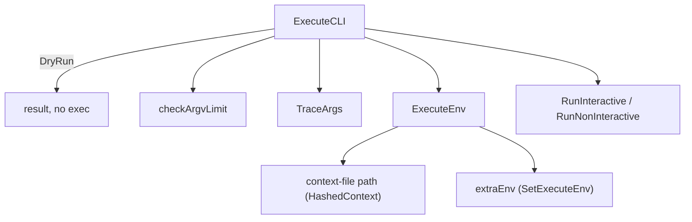

# agent — LaunchBackend (the exec half)

`LaunchBackend` is the shared core a local-CLI engine embeds: the EXEC half
of a launch — child environment assembly, the argv trace, and interactive
vs oneshot routing. Delivery is not this type's: the runner delivers the
launch's package through the static writer (`fsstatic`) before `Execute`
runs, as described in [surface delivery](agent-surface-delivery.md).

Authority: `internal/core/agent/launch_backend.go`.

## Types

| Symbol | Purpose |
|---|---|
| `LaunchBackend` | Embeds `BaseBackend`; holds the injected `context` provider, an optional `extraEnv` contributor, and the `engineHomeVar` naming the env var that relocates the engine's config home. |
| `HashedContext` | `ContextProvider` plus the on-disk path of the context it last provided, handed to the child via the context-file env var. |

## Functions

| Symbol | Purpose |
|---|---|
| `LaunchBackend.InitLaunch` | Wires the context provider. Called once from the concrete constructor. |
| `LaunchBackend.SetExecuteEnv` | Registers an extra per-backend child-env contributor on top of the shared `ExecuteEnv`. |
| `LaunchBackend.SetEngineHomeVar` | Names the env var that relocates the engine's config home (claude's `CLAUDE_CONFIG_DIR`); empty for an engine that declares none. |
| `LaunchBackend.ExecuteCLI` | Runs the binary and argv it is handed: dry-run stop, argv-limit refusal, argv trace, env assembly, then interactive vs oneshot routing; propagates the runner error with its exit code. |
| `LaunchBackend.TraceArgs` | Verbosity-gated trace of the binary and argv. |
| `LaunchBackend.ExecuteEnv` | The request env, the SCM context-file path when context was provided, then the per-backend contributor; later entries win on a key clash. |
| `LaunchBackend.Cleanup` | A no-op: the runner owns what it delivered (its static writer's ownership record). |

## Invariants and contracts

- **The argv limit is checked before exec**, so a failure names the payload
  rather than arriving as os/exec's generic "argument list too long"
  (`argvlimit.go`).
- **What is spawned is what the engine composed.** The backend holds no
  binary or args of its own: `ExecuteCLI` takes both as arguments, and
  `kit.ProjectedBackend.Execute` hands it the binary and argv of the Exec the
  engine's Instance composed from the runner's session
  (`Instance(session).Exec(presented)`). A label's `binary_path` and `args`
  reach that Exec only as the session label's binary and args
  (`config.LabelBinary` / `config.LabelArgs`, read by launch's
  `selectEngine`); a label naming no binary gets the engine's own CLI, which
  each engine's Exec defaults. A `binary_path` that is not a string, or
  `args` that are not a list of strings, refuses the launch by label name
  (`config.ErrMalformedLabelValue`) rather than reading as absent: the
  config schema types both, but schema validation at load only warns. The version floor probes the same binary
  (`runner.Deps.EngineVersion`), so the probed and the spawned binary cannot
  diverge.
