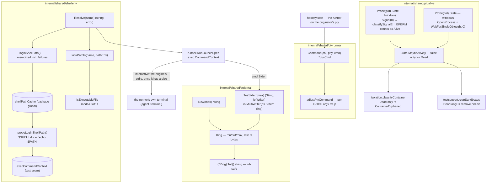

# Process execution and observation

Four leaf packages own how ctxloom starts, watches, and post-mortems a child process. `internal/shared/ptyrunner` translates an os/exec command into one started on a go-pty pseudo-terminal — how the originator starts the runner on the pty it holds the master of (`hostpty`) — and owns the two line disciplines that terminal carries: raw input while it only carries bytes, a new terminal's while an engine runs on it. `internal/shared/shellenv` resolves a bare binary name against the user's login-shell `PATH` when the inherited one is too narrow. `internal/shared/stderrtail` keeps a bounded, streamed tail of a child's stderr so a process that dies can still say why. `internal/shared/pidalive` answers "is a process alive at this pid?".

The contract they jointly own: **an engine binary is found even under a GUI-launched `PATH`, run on the real terminal the human is watching — the one pty the originator holds, inherited through the runner — its dying words are captured before its container is destroyed, and its liveness can be probed afterward by pid alone.**

## `internal/shared/ptyrunner`

The one translation from an os/exec command to a go-pty one, and the line disciplines of the terminal the runner and its engine share. `Command`'s sole production caller is `hostpty.start`, which starts the runner on the pty whose master the originator keeps; `hostpty` makes that pty's input raw (`RawInput`), and `runner.RunLaunchSpec` gives the engine a new terminal's line discipline for its lifetime (`FreshLineDiscipline`). The engine itself is never started on a pty of the runner's own: `runner.RunLaunchSpec` hands it the runner's terminal (see the invariants below).

| Symbol | File | Purpose |
|---|---|---|
| `Command(ctx, ptty pty.Pty, cmd *exec.Cmd) *pty.Cmd` | `internal/shared/ptyrunner/ptyrunner.go` | Re-derives go-pty's `Cmd` from `cmd` (Path, Args[1:], Dir, Env), then `adjustPtyCommand` |
| `RawInput(tty *os.File) error` (!windows) | `internal/shared/ptyrunner/terminal_unix.go` | Input processing off (no echo, no canonical lines, no CR→LF, no signals from keys); output processing left on |
| `FreshLineDiscipline(tty *os.File) (restore func() error, error)` | `internal/shared/ptyrunner/terminal_unix.go`, `prepare_windows.go` | Sets a new pty's input, output and local flags (canonical, echo, ICRNL, ISIG, OPOST/ONLCR); `restore` writes back the termios it found. No-op on Windows |
| `ioctlGetTermios` / `ioctlSetTermios` | `internal/shared/ptyrunner/termios_linux.go`, `termios_other.go` | `TCGETS`/`TCSETS` on Linux, `TIOCGETA`/`TIOCSETA` elsewhere |
| `adjustPtyCommand(c *pty.Cmd, cmd *exec.Cmd)` (!windows) | `internal/shared/ptyrunner/prepare_other.go` | No-op (build-tag seam) |
| `adjustPtyCommand(c *pty.Cmd, cmd *exec.Cmd)` (windows) | `internal/shared/ptyrunner/prepare_windows.go` | For `.cmd`/`.bat`, rewrites to `cmd.exe` with a double-quoted `/c` line via `windows.ComposeCommandLine`; silently no-ops for other extensions |

## `internal/shared/pidalive`

One tri-state verdict type and one build-tagged probe, no state. A leaf with no internal dependencies, so any layer may import it without creating a cycle.

| Symbol | File | Purpose |
|---|---|---|
| `State` (`Dead`, `Alive`, `Unsure`) | `internal/shared/pidalive/pidalive.go` | `Unsure` makes "I could not tell" representable instead of collapsing it into a confident answer |
| `(State).MaybeAlive() bool` | `internal/shared/pidalive/pidalive.go` | True for `Alive` and `Unsure`, false only for a confirmed `Dead` — the conservative policy for a refuse/skip decision |
| `Probe(pid int) State` (!windows) | `internal/shared/pidalive/pidalive_unix.go` | `Unsure` for a pid that cannot name one process (`pidNamesOneProcess`); otherwise `os.FindProcess` → `p.Signal(syscall.Signal(0))` → `classifySignalErr`: nil or `EPERM` ⇒ `Alive`, `ESRCH` or `os.ErrProcessDone` ⇒ `Dead`, anything else ⇒ `Unsure`, all via `errors.Is` |
| `Probe(pid int) State` (windows) | `internal/shared/pidalive/pidalive_windows.go` | `Unsure` for a pid that cannot name one process or exceeds `uint32`; otherwise `OpenProcess(PROCESS_QUERY_LIMITED_INFORMATION\|SYNCHRONIZE)`: `ERROR_ACCESS_DENIED` ⇒ `Alive`, `ERROR_INVALID_PARAMETER` ⇒ `Dead`, other errors ⇒ `Unsure`. An opened handle is closed on every return, and `WaitForSingleObject(h, 0)` decides: `WAIT_OBJECT_0` ⇒ `Dead`, `WAIT_TIMEOUT` ⇒ `Alive`, anything else ⇒ `Unsure` |

| Consumer | Site | Cost of a false "dead" | Cost of a false "alive" |
|---|---|---|---|
| `internal/adapters/isolation` container reaper | `classifyContainer` — reaps only on `!MaybeAlive()` | a live owner's container is removed | an orphaned container lingers |
| `internal/testsupport` sandbox sweep | `reapSandboxes` — removes a pid-named dir on `!MaybeAlive()` or age | a running test's sandbox is deleted | a stale sandbox lingers until the age fallback |

## `internal/shared/stderrtail`

A bounded, mutex-guarded tail of a child's stderr, filled by the child's own stderr pump as bytes arrive. Created 2026-07-24 after a containerized-agent incident where a dying engine adapter's last words went to a `--rm` container's stdout and were unrecoverable.

| Symbol | file:line | Purpose |
|---|---|---|
| `DefaultBytes = 8192` | `internal/shared/stderrtail/stderrtail.go:39` | The standard tail budget |
| `Ring` | `internal/shared/stderrtail/stderrtail.go:43` | Fields `mu sync.Mutex`, `buf []byte`, `max int`. An `io.Writer` retaining only the last `max` bytes |
| `New(max int) *Ring` | `internal/shared/stderrtail/stderrtail.go:50` | Substitutes `DefaultBytes` when `max <= 0` (`:51-53`) |
| `(*Ring).Write(p []byte) (int, error)` | `internal/shared/stderrtail/stderrtail.go:61` | Lock, append (`:64`), drop the front if over budget (`:65-66`), `return len(p), nil` |
| `(*Ring).Tail() string` | `internal/shared/stderrtail/stderrtail.go:72` | Nil-receiver safe (`:73-75`); lock; `strings.TrimSpace(string(r.buf))` |
| `TeeStderr(max int) (*Ring, io.Writer)` | `internal/shared/stderrtail/stderrtail.go:86` | `New(max)` plus `io.MultiWriter(os.Stderr, ring)` — the additive-capture spelling |

| Consumer | Site | Shape |
|---|---|---|
| `internal/adapters/isolation` | `startDirectRunner` (`stderrtail.New`) | tail read via `RunnerHandle.StderrTail` |

A related but distinct implementation of the bounded-byte-tail concept lives at `internal/adapters/termui/ring.go:6-54` (`Ring` — a true fixed-capacity circular buffer with a `dropped` counter and `Drain()`-and-reset, deliberately not goroutine-safe).

## `internal/shared/shellenv`

Widens binary resolution from the process's inherited `PATH` to the user's login+interactive shell `PATH`. Solves the detached-GUI launch (Dock icon, editor extension host) that inherits a bare `PATH` without nvm/rbenv/homebrew/`~/go/bin`, sometimes with `$SHELL` unset. Consumers: `git grep 'shellenv\.Resolve'` — the runner's spawn path (`runner.resolveBinaryPath`) and the engine-availability probe in `internal/adapters/operations`.

> Navigation note: a second, unrelated package is also named `shellenv` — `internal/ltk/shellenv`, whose `ShellFromPath` does thorough shell-family classification. Both are imported under the bare identifier `shellenv`.

| Symbol | file:line | Purpose |
|---|---|---|
| `resolveTimeout = 10s` | `internal/shared/shellenv/shellenv.go:33` | Bound on the probe subprocess |
| `execCommandContext` | `internal/shared/shellenv/shellenv.go:38` | Package-global test seam over `exec.CommandContext` |
| `cache` | `internal/shared/shellenv/shellenv.go:44` | `mu sync.Mutex`, `done bool`, `path string`, `err error`. `done` is load-bearing: `path == "" && err == nil` is a valid outcome, so emptiness cannot be the sentinel |
| `shellPathCache` | `internal/shared/shellenv/shellenv.go:51` | The package-global singleton |
| `resetCacheForTest()` | `internal/shared/shellenv/shellenv.go:56` | Test-only seam; zero production call sites |
| `Resolve(name string) (string, error)` | `internal/shared/shellenv/shellenv.go:70` | Five-step ladder: contains a separator → return as-is (`:71-73`); `exec.LookPath` (`:74`); `loginShellPath` (`:77`) guarded by `err != nil \|\| pathEnv == ""` (`:78`); `lookPathIn` (`:81`); else re-run `exec.LookPath` to return the *original* error (`:79`, `:84`) |
| `lookPathIn(name, pathEnv string) (string, error)` | `internal/shared/shellenv/shellenv.go:92` | `filepath.SplitList` (`:93`), skip empty entries (`:94-96`), first hit where `isExecutableFile` holds |
| `isExecutableFile(path string) bool` | `internal/shared/shellenv/shellenv.go:109` | `os.Stat`; false on error or directory; `info.Mode()&0o111 != 0` (`:114`) |
| `loginShellPath() (string, error)` | `internal/shared/shellenv/shellenv.go:120` | Mutex-held probe-once; caches successes *and* failures |
| `probeLoginShellPath() (string, error)` | `internal/shared/shellenv/shellenv.go:135` | Rejects Windows; `$SHELL` or `/bin/bash`; 10s context; runs `<shell> <args> 'echo $PATH'`; `cmd.Stdout = &out` only; returns `strings.TrimSpace(out.String())` (`:152`) |
| `loginShellArgs(shell, cmd string) []string` | `internal/shared/shellenv/shellenv.go:161` | `fish`/`tcsh` → `-i -c`; everything else → `-l -i -c` |

## Invariants and contracts

**Interactive launch (`runner.RunLaunchSpec`)**

- **One pty, no relay.** The engine inherits the runner's own stdio (`agent.Terminal`): on the host the pty slave the originator holds the master of, in a container the `-it` tty the docker CLI attaches on that same pty. Nothing in the runner reads the terminal, writes into it, or relays a resize; keystrokes, the engine's bytes and window sizes cross the kernel's pty (and the daemon's tty) only, and the engine's newlines cross one line discipline.
- **The engine stays in the runner's session and process group**, on the runner's controlling terminal, so a resize the frontend applies reaches it as a SIGWINCH, and the kernel hangs it (and anything it spawned there) up when the runner — the session leader — exits.
- **First paint.** `hostpty` creates the pty unsized and the frontend sizes it only once it has taken the human's terminal over, so the launch holds the engine until the terminal reports a non-zero size (`waitForTerminalSize`), bounded by `terminalSizeWait` for a frontend with no terminal of its own. It polls the size rather than waiting for SIGWINCH: the read is the terminal's state whoever's controlling terminal it is.
- **A new terminal's line discipline.** The runner's terminal carries raw input while only bytes cross it (`hostpty`), and an engine that reads its terminal as it finds it — a line at a time, Enter arriving as CR — would wait on that forever. So the engine is started on the discipline a new pty has (`ptyrunner.FreshLineDiscipline`), as the relay pty used to give it, and the runner's raw input is put back once the engine exits. A TUI engine sets its own raw mode over it, as it would on any terminal.
- **Refused, not degraded:** an interactive spec with no terminal, or whose stdin or stdout is not one, fails before anything starts.
- **No pipes, no copier.** `Wait` returns at the engine's exit whatever it left holding the terminal; a holder that outlives the runner is bounded by the frontend's drive (`driveOwnedInteractive`'s `ptyDrainGrace`) and hung up with the runner's session.
- Exit classification routes `*exec.ExitError` through `exitstatus.Of` in both branches: an ordinary exit propagates `exitErr.ExitCode()` verbatim, and a child killed by a signal reports the shell convention `128+signum` (130 SIGINT, 137 SIGKILL, 143 SIGTERM) rather than os/exec's raw `-1`, which is not a valid POSIX status and reached the user truncated to `255`. On Windows the mapping is a documented no-op: `syscall.WaitStatus` there hard-codes `Signaled() == false`, so the `ExitCode()` fallthrough runs.
- Windows (unverified on any host this was built on): the engine inherits the runner's console handles, so it attaches to the ConPTY `hostpty` started the runner on. `adjustPtyCommand`'s `.cmd`/`.bat` rewrite applies to what `hostpty` starts, not to the engine, which os/exec starts as it starts a one-shot engine.

**Pty start (`ptyrunner`)**

- `Command` tolerates a nil `Args`, but a caller's own `cmd.Args[0]` cannot reach the child: go-pty rebuilds argv with `Path` as argv[0].

**Liveness (`pidalive`)**

- **EPERM means alive.** The naive `syscall.Kill(pid, 0) == nil` reports every process the caller does not own as dead; ctxloom runs agents under remapped UIDs, so this matters. `ERROR_ACCESS_DENIED` is the Windows analogue and maps the same way.
- **Opening is not liveness on Windows.** A process object outlives its process while any handle to it is held, so `OpenProcess` succeeds on an exited process; the zero-timeout wait on the handle is what decides.
- **Every caller decides on `MaybeAlive`, never `== Alive`.** Both consumers make a destructive decision, so `Unsure` must skip exactly like a confirmed-live owner.
- **Out-of-range pids are `Unsure` on both platforms.** `kill(2)` reads 0 and negatives as process groups; `pidNamesOneProcess` rejects them before probing so the platforms give the same answer.
- **No PID-reuse protection.** The question answered is "is *a* process alive at this pid", never "is *my* process alive". A recycled pid reads as `Alive`, which errs toward a skipped reap; closing that window needs an identity token persisted alongside the pid by the record's owner, not by this package.
- The `internal/shared/liveness` watchdog does not use this package: its `ProcState` comes from `coord.runnerHeartbeatProbe`, which reports `Observed:false` when no runner is connected, so `deathRung`'s `!ev.Proc.Observed || ev.Proc.Alive` guard is what keeps an unseen runtime from being declared dead.

**Stderr tail (`stderrtail`)**

- **STREAMED, not polled.** The tail is filled as bytes arrive, so it survives the child *and its container* being destroyed. `docker logs` on a `--rm` container vanishes exactly when it is needed.
- **BOUNDED**, because the text is forwarded into transcripts and mailboxes. `New(0)` substitutes `DefaultBytes` — without that guard a zero budget would empty the buffer on every write and `Tail()` would always return `""`, a diagnostic sink that silently captures nothing.
- **A tail, not a head** — a dying process says why at the end.
- **`Write` never errors and never short-writes**, deliberately: a diagnostic sink that could fail would put back-pressure on the child's stderr.
- **Capture is ADDITIVE via `TeeStderr`.** The obvious `cmd.Stderr = ring` silently removes a passthrough an operator may depend on. Both spellings are offered; `direct_runner.go:130` and `host_runner.go:73` use plain `New` and do replace stderr.
- `Tail()` is nil-receiver safe and returns `""` when the child said nothing; consumers guard on non-emptiness before wrapping it into an error.
- Peak memory is bounded by the largest *single* write, not by `max`: `append` happens before the budget check, so one 50 MB line transiently grows `buf` to 50 MB before re-slicing to 8 KB.
- `DefaultBytes` is re-aliased to a private constant at `internal/adapters/isolation/direct_runner.go`, while `internal/adapters/isolation/attach.go` uses it directly.

**PATH resolution (`shellenv`)**

- **`Resolve` only ever WIDENS what resolves; it never narrows or reshapes a failure** (`shellenv.go:66-69`). Both failure returns hand back the *original* `exec.LookPath` error, so a genuinely-missing binary produces exactly the message it always did. `runner.resolveBinaryPath` mirrors this posture in writing.
- A name containing a path separator short-circuits and is returned unchanged — an operator-configured explicit path is never second-guessed.
- The login-shell probe runs **at most once per process**, under a mutex so concurrent first-callers serialize rather than spawning duplicate shells, and **caches failures identically to successes** — one transient failure disables the fallback for the life of the process.
- The probe is Windows-rejected, defaults `$SHELL` to `/bin/bash` when unset, and is bounded at 10s.
- `-i` is passed deliberately: the PATH additions live in `.zshrc`/`.bashrc` as often as in the login files.
- **The probe's stdout is taken verbatim, unfenced.** Anything an rc file prints (fastfetch, MOTD, nvm notices, direnv, oh-my-zsh prompts) lands in the buffer and is split on `:` by `filepath.SplitList`, and because `lookPathIn` returns the *first* matching directory, a garbage prefix can shadow a real hit. The cited model implementation (VS Code's `getUnixShellEnvironment`) fences its output with a marker; this one does not.
- `cmd.Stderr` is never set, so the probe subprocess's stderr goes to `/dev/null` and the wrapped error carries only the exit status.
- `probeLoginShellPath` returns `("", nil)` — success with an empty payload — when the shell runs but prints nothing. The **only** guard is the caller-side `|| pathEnv == ""` at `shellenv.go:78`; without it, `lookPathIn("")` reports "not found" for every binary on the machine.
- Real vs documented: `isExecutableFile`'s doc claims it applies "exec.LookPath's own criterion", but it tests raw mode bits while `exec.LookPath` on Unix uses `unix.Eaccess(file, unix.X_OK)` — a `0700` file owned by another user matches here and is rejected at spawn.
- Two mutable package-level variables (`execCommandContext`, `shellPathCache`) plus `resetCacheForTest` mean this package's tests cannot run in parallel and `Resolve`'s result depends on process history.
- `loginShellArgs` treats every unrecognised shell as bash-compatible (`default:` → `-l -i -c`), which is wrong for at least `csh`.
